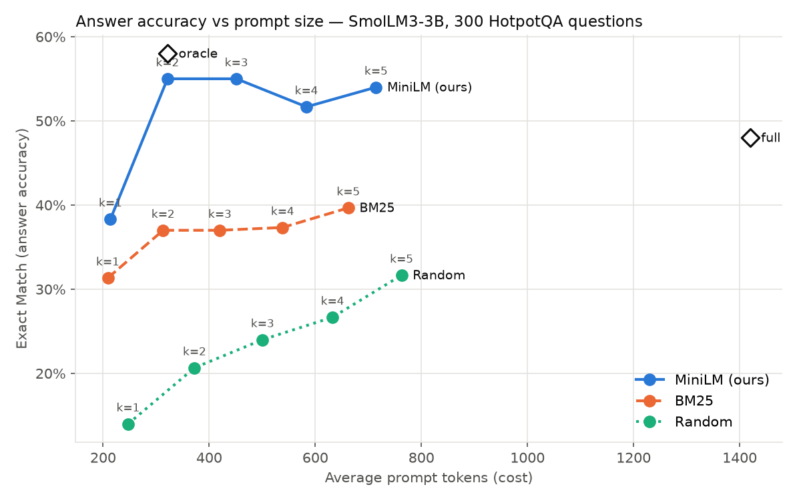

# Prompt Compression with Relevance Maintainer

NLP (CS6120) project. Long prompts are expensive and mostly noise. We trained a **relevance classifier** that scores each context paragraph against the question, so we can compress a prompt to its top-*k* paragraphs **without losing what's needed to answer it**.

## Overview

| Section | Content |
|---|---|
| 0 | **Experiment configuration:** all hyper-parameters in one papermill `parameters` cell, plus the `⏱` cell timer |
| 1–2 | Install dependencies, download and inspect HotpotQA |
| 3–4 | **Whole dataset** (train + validation, 97,852 questions), **80/20 train/test split by question** with a 5% dev set held out of train, expanded into paragraph pairs |
| 5 | Baseline: TF-IDF + logistic regression |
| 6 | Export 250 random questions to Excel for manual review |
| 7 | BM25 ranking on the whole dataset |
| 8 | Fine-tune the `cross-encoder/ms-marco-MiniLM-L-6-v2` cross-encoder, compare all models, compression demo |
| 9 | **End-to-end answer test:** a local LLM (`SmolLM3-3B`) answers 300 test questions from full, oracle, random, BM25 and MiniLM-compressed prompts (k = 1–5), scored with Exact Match / F1 against tokens saved |
| 10 | **Experiment report:** every setting, metric and timing → `results/experiments.csv`; only the best MiniLM model is kept |

Everything is in [`relevance_classifier.ipynb`](relevance_classifier.ipynb). [`run_experiments.py`](run_experiments.py) runs the whole notebook once per hyper-parameter combination.

## Metrics

We evaluate two things: **(A)** does the relevance model keep the right paragraphs, and **(B)** does the LLM still answer correctly from the compressed prompt, and how much smaller is it?

### A. Relevance model

| Metric | What it tells us |
|---|---|
| **Accuracy** | Share of paragraphs classified correctly. Misleading on its own: 80% of paragraphs are distractors, so dropping everything scores 80%. |
| **Precision** | Of the paragraphs kept, how many were needed. Higher → more compression. |
| **Recall** | Of the paragraphs needed, how many were kept. Higher → evidence survives. This matters most: a dropped paragraph can make the answer impossible, an extra distractor only costs tokens. |
| **F1** | Balance of precision and recall. |
| **ROC-AUC** | Ranking quality without a threshold (0.5 = random, 1.0 = perfect). |
| **All gold in top-k** | Share of questions with every gold paragraph in the top-k of 10. **Our main compression metric.** k = 2 keeps 20% of the context. |

### B. End-to-end

| Metric | Meaning |
|---|---|
| **EM / answer F1** | Exact match and word-overlap partial credit against the gold answer (not the classification F1 above). |
| **Token reduction** | Share of prompt tokens removed vs. the full prompt. |
| **EM retained** | Condition EM ÷ full-prompt EM. Above 100% means compression improved answers. |
| **Answer preservation** | Of the questions the full prompt got right, the share still right after compression. |
| **Fixed / broken** | Questions compression turned wrong → right and right → wrong. |
| **Tokens per correct answer** | Prompt tokens ÷ correct answers. Lower is better. |

A good compressor shows **high token reduction with high answer preservation and few broken answers**.

---

## Approach

```
                 ┌──────────────────────── OUR PROJECT ─────────────────────────┐
question  ──┐    │                                                              │
            ├──► │  Relevance model scores every paragraph against the question │
10 paragraphs┘   │  → keep the top-k (e.g. k = 3) → put them back in order      │
                 └───────────────────────────────┬──────────────────────────────┘
                                                 │  compressed prompt (~70% fewer tokens)
                                                 ▼
                                   Answering LLM reads it → writes the answer
```

There are two separate models: the **relevance model** we train (it only scores paragraphs), and the **answering LLM** (Section 9) that reads the compressed prompt.

### Data: HotpotQA (Sections 1–2)

We used [HotpotQA](https://huggingface.co/datasets/hotpotqa/hotpot_qa) (`distractor` config), a multi-hop QA dataset. Each question comes with **10 paragraphs: 2 gold, 8 distractors** chosen for word overlap with the question. A paragraph is labelled relevant if its title appears in `supporting_facts`. Gold evidence averages ~72 words against ~944 for the full context, so **only ~8% of each prompt matters**.

Two question types matter throughout:
- **Comparison** ("Which airport is in Maine, A or B?"): both entities are in the question, so word matching finds them.
- **Bridge** ("What nationality was James Henry Miller's wife?"): the second-hop paragraph (about Peggy Seeger) never mentions Miller, so it's the hardest case.

### Splits and training pairs (Sections 3–4)

- Whole dataset: `train` (90,447) + `validation` (7,405) = 97,852 questions (`SAMPLE_FRAC = 1.0`).
- **80/20 train/test split by question** (`TEST_FRAC = 0.20`), with **5% of train held out as dev** (`DEV_FRAC = 0.05`): ≈74.4k train, ≈3.9k dev, ≈19.6k test. Dev is used only for model selection.
- Fixed seed (`SEED = 42`), so every model is compared on the same test questions.
- Each question becomes 10 `(qid, question, paragraph, label)` rows, where `paragraph` = title + text. That gives ~740k train, 39k dev and 195k test pairs, 20% positive; we handle the imbalance with class weights.

### Baselines (Sections 5, 7)

- **TF-IDF + logistic regression:** element-wise product of question and paragraph TF-IDF vectors (uni/bigrams, fitted on train only) plus cosine similarity, `class_weight="balanced"`. Word overlap only.
- **BM25:** unsupervised (`k1 = 1.5`, `b = 0.75`), IDF computed across the whole dataset.

### Manual review sheet (Section 6)

`data/hotpotqa_250_manual_review.xlsx` holds 250 random questions with evidence sentences, all 10 paragraphs tagged **★ RELEVANT** or *distractor*, and an empty `notes` column for inspecting failures.

### MiniLM cross-encoder (Section 8)

We fine-tuned `cross-encoder/ms-marco-MiniLM-L-6-v2`: already trained for query–passage relevance on MS MARCO, small (6 layers, ~22M params) and fast at inference, which matters because a compressor scores every chunk of every prompt.

1. **Zero-shot evaluation** to measure how much MS MARCO transfers on its own.
2. **Fine-tuning** on ~740k pairs: weighted BCE (`pos_weight` ≈ 4), AdamW (default LR 2e-5), 10% warm-up then linear decay, gradient clipping, bf16 + TF32. About 10–20 min per epoch on an RTX 5070 Ti. The model is saved to `models/minilm-run-<RUN_NAME>/`; if that folder exists, training is skipped.
3. **Comparison** against TF-IDF and BM25 on the same test set, plus the dev score used for model selection.
4. **Compression demo** on one real prompt.

For ranking evaluation, we score all 10 paragraphs, keep the top *k* by score, and check whether **both** gold paragraphs survived. *k* is the compression dial: k = 2 keeps 20% of the context, k = 3 keeps 30%, k = 5 keeps 50%.

### End-to-end answer test (Section 9)

"All gold in top-k" is a proxy, so we also check whether the answer is still right. For 300 test questions (`N_EVAL_QUESTIONS`), we give the **same LLM the same instruction** with different contexts:

| Condition | Context | Purpose |
|---|---|---|
| `full` | all 10 paragraphs | reference |
| `oracle` | the 2 gold paragraphs | ceiling |
| `random@k` | k random paragraphs | floor |
| `bm25@k` | BM25's top-k | word-overlap baseline |
| `minilm@k` | MiniLM's top-k | **our model** |

Each `@k` runs at k = 1–5: 17 conditions × 300 = 5,100 answers per run.

**Answering LLM.** `HuggingFaceTB/SmolLM3-3B`, local, bf16 (~6 GB VRAM), greedy decoding, thinking mode off, and `/system_override` to keep the date out of the prompt. We switched from `Qwen/Qwen3-4B-Instruct-2507` (run 0) because it left too little VRAM for batching on a 16 GB card.

**Prompt wording.** SmolLM3 took our original instruction too literally and answered "yes"/"no" to 168 of 300 non-yes/no questions. We A/B tested three versions:

| Instruction | Oracle EM | Oracle F1 | Full EM | Full F1 | Wrong yes/no (oracle) |
|---|---|---|---|---|---|
| original ("a short phrase, yes, or no") | 28.3% | 32.6% | 36.0% | 47.2% | 168 |
| "if yes/no question, yes/no; otherwise a short phrase" | 57.7% | 67.7% | 45.0% | 56.8% | 31 |
| **"shortest phrase from the context; yes/no only for yes/no questions"** (used) | **58.3%** | **70.2%** | **48.0%** | **58.2%** | **7** |

**GPU memory.** Run 0 crashed with CUDA OOM on the longest prompts after Windows started spilling VRAM into system RAM. We fixed it with:
- **Token-budget batching:** a batch closes at `GEN_BATCH_SIZE` (16) prompts or `GEN_MAX_BATCH_TOKENS` (16,384) tokens, whichever comes first.
- **A hard VRAM cap:** free VRAM at start-up minus `GPU_HEADROOM_GB` (1 GB).
- **Automatic retry:** an OOM batch is split in half and retried.

**Caching.** Answers are cached in `results/e2e_cache_<model>.jsonl`, keyed by a prompt hash. Prompts shared across runs are generated once; `minilm@k` prompts regenerate only when the kept paragraphs change. Interrupted runs resume.

**Scoring** uses the official HotpotQA EM / F1 with standard answer normalisation.

### Hyper-parameter sweep (Section 10, `run_experiments.py`)

[`run_experiments.py`](run_experiments.py) uses [papermill](https://papermill.readthedocs.io) to run the full notebook once per combination:

| Run | `TRAIN_BATCH_SIZE` | `LEARNING_RATE` | `EPOCHS` | `MAX_LENGTH` |
|---|---|---|---|---|
| `r1_baseline` | 32 | 2e-5 | 1 | 256 |
| `r2_bs16` | 16 | 2e-5 | 1 | 256 |
| `r3_bs64_lr4e-5` | 64 | 4e-5 | 1 | 256 |
| `r4_len384` | 32 | 2e-5 | 1 | 384 |
| `r5_2epochs` | 32 | 2e-5 | 2 | 256 |

All runs share the same split, `N_EVAL_QUESTIONS = 300`, `K_VALUES = [1, 2, 3, 4, 5]`, `GEN_BATCH_SIZE = 16` and SmolLM3-3B.

Each run produces `experiments/<run>.ipynb`, one row in `results/experiments.csv` (settings, all metrics, `⏱` timings, peak VRAM), and `results/runs/<run>_answers.csv` + `<run>_accuracy_vs_tokens.png`.

**Model selection:** each run's MiniLM is compared with the best so far on **dev** top-2 (tracked in `models/minilm-hotpotqa-best/best_run.json`). The winner is kept and the rest deleted. Test never influences selection.

**Next step: GSM8K.** Everything after the evaluation-set cell only depends on questions, chunks, gold positions and scores, so we plan to reuse it with few-shot worked examples as the chunks and a numeric-answer metric.

---

## Results

All numbers come from `results/experiments.csv`; each run's full output is in `experiments/<run>.ipynb`, and the main notebook shows the best run, `r5_2epochs`. We re-ran `r5_2epochs` after adding the accuracy and compression metrics and it reproduced within 0.02 points (MiniLM) and one question (LLM). For runs 1–4, the new metrics were computed from their saved answers. Hardware: RTX 5070 Ti (16 GB), Intel Core Ultra 7 265KF, 32 GB RAM.

### Relevance models (19,571 test questions, best run `r5_2epochs`)

| Model | Top-2 | Top-3 | Top-4 | Top-5 | ROC-AUC | Accuracy | Precision | Recall | F1 |
|---|---|---|---|---|---|---|---|---|---|
| TF-IDF + LR | 19.1% | 29.4% | 37.8% | 44.9% | 0.642 | 0.658 | 0.306 | 0.555 | 0.395 |
| BM25 (unsupervised, whole dataset) | 25.6% | 37.1% | 44.8% | 51.0% | 0.666 | – | – | – | – |
| MiniLM zero-shot (MS MARCO only) | 44.3% | 58.1% | 66.3% | 71.8% | 0.813 | 0.725 | 0.404 | 0.776 | 0.531 |
| **MiniLM fine-tuned** | **89.1%** | **95.5%** | **97.6%** | **98.7%** | **0.989** | **0.957** | **0.866** | **0.928** | **0.896** |

*Top-k = share of test questions with both gold paragraphs in the top-k of 10. Classification metrics are for the relevant class at p ≥ 0.5; BM25 has no probability.*

- The trivial "all irrelevant" model scores **79.9%** accuracy. TF-IDF and zero-shot MiniLM score below that but are still far more useful (55% and 78% recall vs. 0%). Only the fine-tuned model is strong on every measure.
- Word-overlap methods plateau because HotpotQA's distractors were picked for word overlap: BM25 keeps all evidence in only half the prompts even at top-5. Our fine-tuned cross-encoder does it in the top-2 for 89% of questions.

### Hyper-parameter sweep (5 runs)

| Run | Batch | LR | Epochs | Max len | **Dev top-2** | Test top-2 | Test top-3 | ROC-AUC | Accuracy | Precision | Recall | F1 | Final loss | Fine-tune time | Total time |
|---|---|---|---|---|---|---|---|---|---|---|---|---|---|---|---|
| `r1_baseline` | 32 | 2e-5 | 1 | 256 | 87.46% | 87.12% | 94.65% | 0.9866 | 0.948 | 0.833 | 0.929 | 0.878 | 0.278 | 11.1 min | 22.7 min |
| `r2_bs16` | 16 | 2e-5 | 1 | 256 | 88.56% | 87.65% | 94.84% | 0.9873 | 0.956 | **0.880** | 0.904 | 0.892 | 0.346 | 17.1 min | 23.9 min |
| `r3_bs64_lr4e-5` | 64 | 4e-5 | 1 | 256 | 88.58% | 88.18% | 95.07% | 0.9881 | 0.947 | 0.822 | **0.942** | 0.878 | 0.252 | **9.7 min** | **16.6 min** |
| `r4_len384` | 32 | 2e-5 | 1 | 384 | 87.92% | 87.28% | 94.68% | 0.9867 | 0.949 | 0.838 | 0.925 | 0.879 | 0.270 | 14.6 min | 22.2 min |
| **`r5_2epochs`** (best) | 32 | 2e-5 | 2 | 256 | **89.27%** | **89.07%** | **95.49%** | **0.9893** | **0.957** | 0.866 | 0.928 | **0.896** | 0.199 | 22.2 min | 29.8 min |

- **Two epochs win** on dev and on every test ranking metric: +2.0 points top-2 over the baseline (~380 more questions whose evidence survives 20% compression). Dev and test agree.
- `r3` has the highest recall but lowest precision; `r2` is the opposite. `r5` balances both best.
- `r3` (batch 64, LR 4e-5) is the best one-epoch setting and the fastest run.
- `MAX_LENGTH = 384` adds time but no gain; almost every pair fits in 256 tokens.
- Peak VRAM: 1.6–2.3 GiB training, 8.3–8.5 GiB generating (cap 13.7 GiB). No spills or OOMs.
- The answer cache cut later runs' generation from 5.3 min to 10–20 s.

### End-to-end answer accuracy (`r5_2epochs`, SmolLM3-3B, 300 test questions)

| Condition | Avg prompt tokens | Token reduction | All gold kept | EM | F1 | EM retained | Answer preservation | Fixed / broken | Tokens per correct answer |
|---|---|---|---|---|---|---|---|---|---|
| `full` (10 paragraphs) | 1,419 | 0% | 100% | 48.0% | 58.7% | 100% | 100% | – | 2,957 |
| `oracle` (2 gold paragraphs) | 321 | 76% | 100% | 58.0% | 70.1% | 121% | 86% | 50 / 20 | 554 |
| `random@1` | 247 | 82% | 0% | 14.0% | 17.2% | 29% | 22% | 11 / 113 | 1,766 |
| `bm25@1` | 209 | 85% | 0% | 31.3% | 37.9% | 65% | 52% | 19 / 69 | 667 |
| **`minilm@1`** | 214 | 84% | 0% | **38.3%** | **47.8%** | **80%** | **63%** | 24 / 53 | **558** |
| `random@2` | 372 | 73% | 2.7% | 20.7% | 25.1% | 43% | 29% | 20 / 102 | 1,802 |
| `bm25@2` | 313 | 77% | 24.0% | 37.0% | 44.4% | 77% | 58% | 27 / 60 | 846 |
| **`minilm@2`** | 321 | 76% | **89.7%** | **55.0%** | **67.2%** | **115%** | **82%** | **47 / 26** | **584** |
| `random@3` | 501 | 64% | 6.0% | 24.0% | 27.9% | 50% | 39% | 16 / 88 | 2,086 |
| `bm25@3` | 420 | 69% | 38.7% | 37.0% | 44.7% | 77% | 59% | 26 / 59 | 1,136 |
| **`minilm@3`** | 451 | 67% | **95.7%** | **55.0%** | **66.7%** | **115%** | **83%** | 45 / 24 | **821** |
| `random@4` | 632 | 55% | 12.7% | 26.7% | 33.9% | 56% | 45% | 15 / 79 | 2,372 |
| `bm25@4` | 538 | 61% | 44.7% | 37.3% | 45.5% | 78% | 62% | 23 / 55 | 1,442 |
| **`minilm@4`** | 584 | 58% | **98.3%** | **52.0%** | **64.2%** | **108%** | **85%** | 34 / 22 | **1,123** |
| `random@5` | 763 | 46% | 21.0% | 31.7% | 39.2% | 66% | 52% | 20 / 69 | 2,409 |
| `bm25@5` | 662 | 52% | 52.3% | 39.7% | 48.2% | 83% | 68% | 21 / 46 | 1,670 |
| **`minilm@5`** | 715 | 49% | **98.3%** | **54.3%** | **64.6%** | **113%** | **90%** | 33 / 14 | **1,315** |



- **MiniLM top-2 removes 76% of the prompt** (1,419 → 321 tokens) and keeps **82% of the full prompt's correct answers**, while fixing 47 and breaking 26. EM rises from 48.0% to 55.0%, within 3 points of the oracle.
- **5× cheaper per correct answer:** 584 tokens with `minilm@2` vs. 2,957 with the full prompt (BM25: 846, random: 1,802).
- **Not all lost answers are compression's fault.** Even the oracle preserves only 86%. Of the 24 answers `minilm@3` lost, 92% still had all gold paragraphs, so those errors come from the reader LLM.
- **k = 2–3 is the sweet spot:** best EM and lowest cost per correct answer. Answer preservation climbs from 63% (k = 1) to 90% (k = 5), but extra distractors slightly lower EM.
- **BM25 loses accuracy** because it drops a gold paragraph in 76% of questions at k = 2. Random is far worse.
- **LLM-accuracy differences between runs are noise:** `minilm@2` scores 54.7–55.0% EM across all five runs. The relevance metrics on 19,571 questions are what separate them.

### Run 0: original configuration with Qwen3-4B

Our first GPU run used a 30% sample (75/25 split), 1 epoch on 20,350 questions, `Qwen/Qwen3-4B-Instruct-2507` as the reader, 500 questions and k = 2, 3, 5. It hit CUDA OOM after 5,472 of 5,500 answers, which led to the batching and VRAM fixes above. Answers are in `results/e2e_hotpotqa_Qwen3-4B-Instruct-2507.jsonl`.

| Condition | Answers | Avg prompt tokens | All gold kept | EM | F1 |
|---|---|---|---|---|---|
| `full` | 472 / 500 | 1,407 | 100% | 65.0% | 72.3% |
| `oracle` | 500 | 305 | 100% | 77.4% | 83.7% |
| `random@2` / `bm25@2` / **`minilm@2`** | 500 | 346 / 302 / 304 | 2.8% / 25.6% / **82.8%** | 17.8% / 41.0% / **70.8%** | 19.9% / 44.7% / **76.4%** |
| `random@3` / `bm25@3` / **`minilm@3`** | 500 | 489 / 415 / 434 | 9.0% / 35.2% / **90.6%** | 25.8% / 43.6% / **69.8%** | 27.8% / 47.2% / **76.6%** |
| `random@5` / `bm25@5` / **`minilm@5`** | 500 | 761 / 660 / 697 | 22.6% / 48.2% / **95.8%** | 35.8% / 49.0% / **68.4%** | 39.0% / 54.0% / **75.0%** |

The larger reader is more accurate overall, but the conclusion holds: **MiniLM top-2 beats the full prompt (70.8% vs 65.0% EM) at ~1/5 of the tokens.** Training on the whole dataset raised MiniLM's k = 2 evidence retention from 82.8% to 89.7% (different question samples, so indicative only).

## Setup

```bash
# Project virtual environment (Windows; on Linux/macOS use .venv/bin/python)
py -3.14 -m venv .venv
.venv\Scripts\python -m pip install torch --index-url https://download.pytorch.org/whl/cu128   # CUDA build (RTX 50-series needs CUDA 12.8+)
.venv\Scripts\python -m pip install -r requirements.txt

# Register it as a Jupyter kernel, then pick "Prompt Optimizer NLP (.venv, CUDA)" in VS Code / Jupyter
.venv\Scripts\python -m ipykernel install --user --name prompt-optimizer-nlp --display-name "Prompt Optimizer NLP (.venv, CUDA)"
```

**Single run:** open the notebook and Run All. Section 1 should print `CUDA: True` and the GPU name.

**Full sweep** (5 runs, ~3–4 h on an RTX 5070 Ti):

```bash
.venv\Scripts\python run_experiments.py            # all runs; finished runs are skipped
.venv\Scripts\python run_experiments.py r4_len384  # a single run
```

- Sections 1–8 fall back to CPU without a GPU, but that's too slow for the whole dataset; lower `SAMPLE_FRAC` / `TRAIN_FRAC`.
- Section 9 needs a CUDA GPU (~6 GB model download, 5–15 min per run). If memory is tight, lower `GEN_MAX_BATCH_TOKENS`.
- Delete `results/e2e_cache_*.jsonl` to force all answers to regenerate.
- To redo the sweep from scratch, delete `results/experiments.csv` and `models/minilm-hotpotqa-best/`.

## Repository layout

```
relevance_classifier.ipynb            main notebook (Sections 0–10)
run_experiments.py                    runs the notebook once per hyper-parameter combination (papermill)
data/hotpotqa_250_manual_review.xlsx  250-question sheet for manual notes (never overwritten by the notebook)
requirements.txt
experiments/                          executed notebook of every sweep run
results/experiments.csv               one row per run: settings, metrics, timings, peak VRAM
results/runs/                         per-run LLM answers and accuracy-vs-tokens plot
results/e2e_cache_*.jsonl             cached LLM answers (git-ignored)
models/minilm-hotpotqa-best/          the best fine-tuned MiniLM across runs + best_run.json (git-ignored)
```