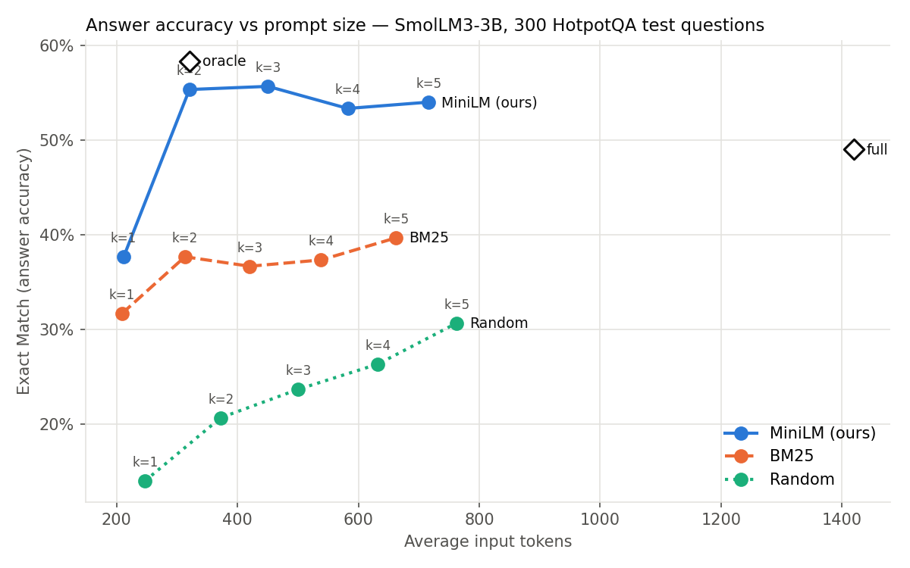

# Prompt Compression with Relevance Maintainer

NLP (CS6120) project. Long prompts are expensive and mostly noise. We train a **relevance classifier** that scores each context paragraph against the question, so a prompt can be cut to its top-*k* paragraphs **without losing what is needed to answer it**.

**Main result** (run `r5_4epochs`, HotpotQA): the fine-tuned MiniLM keeps both gold paragraphs in its top 2 for **89.8%** of test questions (BM25: 25.9%). Cutting the prompt to those 2 paragraphs removes **76% of the tokens** and **raises** answer accuracy: EM 55.6% vs 49.7% for the full prompt on 1,300 test questions, and 56.1% vs 50.8% on 1,300 dev questions. Both gains are significant after correction (McNemar + Holm). Each correct answer costs **5× fewer prompt tokens**.

## Overview

| Section | Content |
|---|---|
| 0 | **Experiment configuration:** every setting in one papermill `parameters` cell, plus the `⏱` cell timer |
| 1–2 | Install dependencies, download and inspect HotpotQA |
| 3–4 | Whole dataset (97,852 questions), **80/20 train/test split by question** with a 5% dev set held out of train, expanded into paragraph pairs |
| 5 | Baseline: TF-IDF + logistic regression |
| 6 | Export 66 random questions to Excel for manual review |
| 7 | Baseline: BM25 ranking |
| 8 | Fine-tune the `cross-encoder/ms-marco-MiniLM-L-6-v2` cross-encoder, compare all models, compression demo |
| 9 | **End-to-end test:** a local LLM (`SmolLM3-3B`) answers 1,300 test questions from full, oracle, random, BM25 and MiniLM prompts (k = 1–5). Exact Match / F1 against tokens saved, with McNemar significance tests |
| 9b | The same tests on the dev questions |
| 10 | **Report:** every setting, metric and timing → `results/experiments.csv`; only the best MiniLM is kept |

Everything is in [`relevance_classifier.ipynb`](relevance_classifier.ipynb). [`run_experiments.py`](run_experiments.py) runs the whole notebook once per hyper-parameter setting.

## Metrics

**(A) Relevance model:** does it keep the right paragraphs?

| Metric | What it tells us |
|---|---|
| **Accuracy** | Share of paragraphs classified correctly. Misleading on its own: 80% are distractors, so dropping everything scores 80%. |
| **Precision** | Of the paragraphs kept, the share that were needed. Higher → more compression. |
| **Recall** | Of the paragraphs needed, the share that were kept. Higher → the evidence survives. Matters most: a dropped paragraph can make the answer impossible, an extra one only costs tokens. |
| **F1** | Balance of precision and recall. |
| **ROC-AUC** | Ranking quality without a threshold (0.5 = random, 1.0 = perfect). |
| **All gold in top-k** | Share of questions with every gold paragraph in the top k of 10. **Our main compression metric**: k = 2 keeps 20% of the context. |

**(B) End-to-end:** does the LLM still answer correctly from the compressed prompt, and how much smaller is it?

| Metric | Meaning |
|---|---|
| **EM / answer F1** | Exact Match, and word-overlap partial credit, against the gold answer (not the classification F1 above). |
| **Token reduction** | Share of prompt tokens removed compared with the full prompt. |
| **EM retained** | Condition EM ÷ full-prompt EM. Above 100% = the compressed prompt scored higher. |
| **Answer preservation** | Of the questions the full prompt got right, the share still right after compression. |
| **Fixed / broken** | Questions that compression turned wrong → right and right → wrong. |
| **Tokens per correct answer** | Prompt tokens ÷ correct answers. Lower is better. |
| **p-value / 95% CI** | McNemar's test on the same questions: is an EM difference bigger than luck, and in what range does the real change probably lie? |

A good compressor shows **high token reduction with high answer preservation and few broken answers**.

---

## Approach

```
                 ┌──────────────────────── OUR PROJECT ─────────────────────────┐
question  ──┐    │                                                              │
            ├──► │  Relevance model scores every paragraph against the question │
10 paragraphs┘   │  → keep the top-k (e.g. k = 3) → put them back in order      │
                 └───────────────────────────────┬──────────────────────────────┘
                                                 │  compressed prompt (~70% fewer tokens)
                                                 ▼
                                   Answering LLM reads it → writes the answer
```

There are two separate models: the **relevance model** we train (it only scores paragraphs), and the **answering LLM** (Section 9) that reads the compressed prompt.

### Data and splits (Sections 1–4)

- [HotpotQA](https://huggingface.co/datasets/hotpotqa/hotpot_qa), `distractor` config: each question comes with **10 paragraphs, 2 gold and 8 distractors** picked for word overlap with the question. A paragraph is relevant if its title is in `supporting_facts`. Gold evidence averages ~72 words against ~944 for the full context, so **only ~8% of each prompt matters**.
- Two question types:
  - **Comparison** ("Which airport is in Maine, A or B?"): both entities are in the question, so word matching finds them.
  - **Bridge** ("What nationality was James Henry Miller's wife?"): the second-hop paragraph (about Peggy Seeger) never mentions Miller. This is the hard case.
- `train` (90,447) + `validation` (7,405) = 97,852 questions, split **80/20 by question**, with **5% of train held out as dev**: ≈74.4k train, ≈3.9k dev, ≈19.6k test. The seed is fixed (`SEED = 42`), so every run uses the same questions. Dev is only used to pick the best run.
- Each question becomes 10 `(qid, question, paragraph, label)` rows: ~740k train, 39k dev and 196k test pairs, 20% positive.

### Baselines (Sections 5, 7)

- **TF-IDF + logistic regression:** element-wise product of the question and paragraph TF-IDF vectors (uni/bigrams, fitted on train only) plus their cosine similarity, `class_weight="balanced"`. Word overlap only.
- **BM25:** unsupervised (`k1 = 1.5`, `b = 0.75`), with IDF computed over the whole dataset. Scored on the test questions like the other models, and on the whole dataset as a check.

### Manual review sheet (Section 6)

`data/hotpotqa_66_manual_review.xlsx` holds 66 random questions with their evidence sentences, all 10 paragraphs tagged **★ RELEVANT** or *distractor*, and an empty `notes` column. The notebook never overwrites it.

### MiniLM cross-encoder (Section 8)

`cross-encoder/ms-marco-MiniLM-L-6-v2` is already trained for query–passage relevance on MS MARCO, small (6 layers, ~22M parameters) and fast. Speed matters because a compressor scores every chunk of every prompt.

1. **Zero-shot test**: how much MS MARCO training helps on its own.
2. **Fine-tuning** on ~740k pairs: weighted BCE (`pos_weight` ≈ 4), AdamW (LR 2e-5), 10% warm-up then linear decay, gradient clipping, bf16 + TF32. About 11 min per epoch at batch 32 on an RTX 5070 Ti.
3. **Comparison** with TF-IDF and BM25 on the same test questions, plus the dev score used to pick the best run.
4. **Compression demo** on one real prompt.

Ranking is evaluated by keeping the top *k* of 10 paragraphs and checking that **both** gold paragraphs survived.

### End-to-end answer test (Sections 9, 9b)

"All gold in top-k" is a proxy, so we also check whether the answer is still right. For 1,300 test questions, and again for 1,300 dev questions (`N_EVAL_QUESTIONS`), the **same LLM gets the same instruction** with different contexts.

| Condition | Context | Purpose |
|---|---|---|
| `full` | all 10 paragraphs | reference |
| `oracle` | the 2 gold paragraphs | ceiling |
| `random@k` | k random paragraphs | floor |
| `bm25@k` | BM25's top k | word-overlap baseline |
| `minilm@k` | MiniLM's top k | **our model** |

Each `@k` runs at k = 1–5: 17 conditions × 1,300 questions = 22,100 answers per question set. 1,300 questions narrow the 95% CI of an EM difference from about ±5.6 points (300 questions) to about ±2.7.

**Answering LLM.** `HuggingFaceTB/SmolLM3-3B`, local, bf16 (~6 GB VRAM), greedy decoding, thinking mode off, and `/system_override` to keep the date out of the prompt. It replaced `Qwen/Qwen3-4B-Instruct-2507` (run 0), which ran out of memory on a 16 GB card. With the memory fixes below, Qwen3-4B now runs as a second reader (`r6_qwen3_4b`).

**Prompt wording.** SmolLM3 took our first instruction too literally and answered "yes" / "no" to 168 of 300 questions that weren't yes/no questions. We A/B tested three versions:

| Instruction | Oracle EM | Oracle F1 | Full EM | Full F1 | Wrong yes/no (oracle) |
|---|---|---|---|---|---|
| original ("a short phrase, yes, or no") | 28.3% | 32.6% | 36.0% | 47.2% | 168 |
| "if yes/no question, yes/no; otherwise a short phrase" | 57.7% | 67.7% | 45.0% | 56.8% | 31 |
| **"shortest phrase from the context; yes/no only for yes/no questions"** (used) | **58.3%** | **70.2%** | **48.0%** | **58.2%** | **7** |

*The A/B test used 300 test questions (now part of the 1,300), so the wording was picked on test data. The dev check in Section 9b (questions never used for the A/B) gives similar results, so the choice does not seem to have inflated the test numbers.*

**GPU memory.** Run 0 crashed with CUDA OOM when Windows started spilling VRAM into system RAM. The fixes:
- **Token-budget batching:** a batch closes at `GEN_BATCH_SIZE` (16) prompts or `GEN_MAX_BATCH_TOKENS` (16,384; 4,096 for Qwen3-4B) tokens, whichever comes first.
- **Hard VRAM cap:** free VRAM at start-up minus `GPU_HEADROOM_GB` (1 GB), or `GPU_MAX_GB` if lower (12 GB for Qwen3-4B). PyTorch never goes over it, so VRAM can't spill.
- **Automatic retry:** a batch that runs out of memory is split in half and retried.

**Caching.** Answers are cached in `results/e2e_cache_<model>.jsonl`, keyed by a hash of the prompt and the generation settings. A prompt is generated once across all runs, and interrupted runs resume. The settings include the `transformers` version, so a library upgrade regenerates every answer.

**Scoring** uses the official HotpotQA EM / F1 with standard answer normalisation.

### Hyper-parameter sweep (Section 10, `run_experiments.py`)

[`run_experiments.py`](run_experiments.py) uses [papermill](https://papermill.readthedocs.io) to run the whole notebook once per setting. The current sweep trains longer than the previous one (3–4 epochs instead of 1–2):

| Run | Batch | LR | Epochs | Max len | Status |
|---|---|---|---|---|---|
| `r1_baseline` | 32 | 2e-5 | 3 | 256 | to run |
| `r2_bs16` | 16 | 2e-5 | 3 | 256 | to run |
| `r3_bs64_lr4e-5` | 64 | 4e-5 | 3 | 256 | to run |
| `r4_len384` | 32 | 2e-5 | 3 | 384 | to run |
| `r5_4epochs` | 32 | 2e-5 | 4 | 256 | **done** (1,300 questions) |
| `r7_bs64_lr3e-5_3ep` | 64 | 3e-5 | 3 | 256 (warm-up 15%) | to run |
| `r6_qwen3_4b` | best run's MiniLM, reader `Qwen3-4B-Instruct-2507` | | | | to run, last |

All runs share the same split, 1,300 evaluation questions per set, k = 1–5 and SmolLM3-3B as the reader, except `r6_qwen3_4b`. That run does not train: it reuses the best MiniLM (`TRAIN_MINILM = False`) and only swaps the reader, under a 12 GB VRAM limit.

Each run writes `experiments/<run>.ipynb`, one row in `results/experiments.csv`, and `results/runs/<run>_answers.csv`, `<run>_dev_answers.csv` and `<run>_accuracy_vs_tokens.png`.

**Model selection:** each run's MiniLM is compared with the best so far on **dev** top-2 (`models/minilm-hotpotqa-best/best_run.json`). The winner is kept and the rest deleted. Test never influences the choice.

**Next step: GSM8K.** Everything after the evaluation-set cell only needs questions, chunks, gold positions and scores, so we plan to reuse it with few-shot worked examples as the chunks.

---

## Results

All numbers come from `results/experiments.csv` (run `r5_4epochs`) unless a note says otherwise. Only `r5_4epochs` of the new sweep has run so far, with 1,300 evaluation questions per set (87 min in total: 43 min of fine-tuning and about 19 min of answers each for test and dev). It ran in the main notebook (Python 3.12.10, transformers 5.17.0), so its outputs are in [`relevance_classifier.ipynb`](relevance_classifier.ipynb). Results of the previous sweep are kept further down. Hardware: RTX 5070 Ti (16 GB), Intel Core Ultra 7 265KF, 32 GB RAM.

### Relevance models (19,571 test questions)

| Model | Top-2 | Top-3 | Top-4 | Top-5 | ROC-AUC | Accuracy | Precision | Recall | F1 | Dev top-2 |
|---|---|---|---|---|---|---|---|---|---|---|
| TF-IDF + LR | 19.1% | 29.4% | 37.8% | 44.9% | 0.642 | 0.658 | 0.306 | 0.555 | 0.395 | 18.5% |
| BM25 (unsupervised) | 25.9% | 37.6% | 45.0% | 51.2% | 0.667 | – | – | – | – | 25.4% |
| MiniLM zero-shot (MS MARCO only) | 44.3% | 58.1% | 66.3% | 71.8% | 0.813 | 0.725 | 0.404 | 0.776 | 0.531 | 43.2% |
| **MiniLM fine-tuned** | **89.8%** | **95.9%** | **97.9%** | **98.9%** | **0.991** | **0.962** | **0.890** | **0.924** | **0.907** | **90.4%** |

*Top-k = share of questions with both gold paragraphs in the top k of 10. Classification metrics are for the relevant class at p ≥ 0.5; BM25 has no probability. Dev = the 3,915 dev questions. On the whole dataset (97,852 questions) BM25 scores 25.6% / 37.1% / 44.8% / 51.0%, ROC-AUC 0.666.*

- The trivial "all irrelevant" model scores **79.9%** accuracy. TF-IDF and zero-shot MiniLM score below that, but they are still far more useful (55% and 78% recall vs 0%). Only the fine-tuned model is strong on every measure.
- Word-overlap methods plateau because HotpotQA's distractors were picked for word overlap: BM25 keeps all the evidence in only half the prompts even at top-5. The fine-tuned cross-encoder does it in the top 2 for 90% of questions.
- Dev and test agree within 1.5 points for every model.

**Bridge vs comparison questions (test):**

| Model | Question type | Questions | Top-2 | Top-3 | Top-4 | Top-5 |
|---|---|---|---|---|---|---|
| BM25 | bridge | 15,779 | 25.1% | 35.8% | 42.6% | 48.3% |
| BM25 | comparison | 3,792 | 29.3% | 45.2% | 55.1% | 63.4% |
| **MiniLM fine-tuned** | bridge | 15,779 | **87.4%** | **94.9%** | **97.4%** | **98.6%** |
| **MiniLM fine-tuned** | comparison | 3,792 | **99.5%** | **100.0%** | **100.0%** | **100.0%** |

- **Almost every remaining miss is a bridge question:** 1,986 of the 2,004 questions that lose a gold paragraph at top-2, and 798 of 799 at top-3. The hard part is the second-hop paragraph that shares few words with the question.

### 2 vs 4 epochs

| Run | Epochs | Dev top-2 | Test top-2 | Test top-3 | ROC-AUC | F1 | Final loss | Fine-tune time | EM `minilm@2` (same 300 questions) |
|---|---|---|---|---|---|---|---|---|---|
| `r5_2epochs` (previous sweep) | 2 | 89.25% | 89.07% | 95.48% | 0.9893 | 0.896 | 0.199 | 52.0 min* | 55.3% |
| **`r5_4epochs`** | 4 | **90.45%** | **89.76%** | **95.92%** | **0.9908** | **0.907** | **0.175** | 43.3 min | 55.3% |

- Two more epochs add **+1.2 points dev top-2** and +0.7 test top-2 (about 135 more test questions with all their evidence in the top 2).
- LLM accuracy did not change: on the same 300 test questions `minilm@2` scores 55.3% EM in both runs (55.6% on all 1,300).
- *`r5_2epochs`' 52 min was an outlier; its earlier runs with the same settings took about 22 min. Four epochs take about 11 min each.

### Previous sweep (1–2 epochs)

| Run | Batch | LR | Epochs | Max len | **Dev top-2** | Test top-2 | Test top-3 | ROC-AUC | Accuracy | Precision | Recall | F1 | Final loss | Fine-tune time | Total time |
|---|---|---|---|---|---|---|---|---|---|---|---|---|---|---|---|
| `r1_baseline` | 32 | 2e-5 | 1 | 256 | 87.46% | 87.12% | 94.65% | 0.9866 | 0.948 | 0.833 | 0.929 | 0.878 | 0.278 | 11.1 min | 22.7 min |
| `r2_bs16` | 16 | 2e-5 | 1 | 256 | 88.56% | 87.65% | 94.84% | 0.9873 | 0.956 | **0.880** | 0.904 | 0.892 | 0.346 | 17.1 min | 23.9 min |
| `r3_bs64_lr4e-5` | 64 | 4e-5 | 1 | 256 | 88.58% | 88.18% | 95.07% | 0.9881 | 0.947 | 0.822 | **0.942** | 0.878 | 0.252 | **9.7 min** | **16.6 min** |
| `r4_len384` | 32 | 2e-5 | 1 | 384 | 87.92% | 87.28% | 94.68% | 0.9867 | 0.949 | 0.838 | 0.925 | 0.879 | 0.270 | 14.6 min | 22.2 min |
| **`r5_2epochs`** (best) | 32 | 2e-5 | 2 | 256 | **89.25%** | **89.07%** | **95.48%** | **0.9893** | **0.957** | 0.866 | 0.928 | **0.896** | 0.199 | 52.0 min | 59.3 min |

*The executed notebooks are in `experiments/<run>.ipynb`. These rows come from `results/experiments.backup_20261118_1804.csv` (git-ignored).*

- More epochs helped most; this is why the new sweep trains for 3–4 epochs.
- `r3` (batch 64, LR 4e-5) was the best and fastest one-epoch setting. `MAX_LENGTH = 384` added time but no gain, since almost every pair fits in 256 tokens.
- LLM accuracy barely differed between runs (`minilm@2`: 54.7–55.3% EM); the relevance metrics on 19,571 questions are what separate them.

### End-to-end answer accuracy (`r5_4epochs`, SmolLM3-3B, 1,300 test questions)

| Condition | Avg prompt tokens | Token reduction | All gold kept | EM | F1 | EM retained | Answer preservation | Fixed / broken | Tokens per correct answer |
|---|---|---|---|---|---|---|---|---|---|
| `full` (10 paragraphs) | 1,436 | 0% | 100% | 49.7% | 60.0% | 100% | 100% | – | 2,889 |
| `oracle` (2 gold paragraphs) | 326 | 76% | 100% | 57.8% | 69.2% | 116% | 85% | 205 / 99 | 564 |
| `random@1` | 246 | 82% | 0% | 15.2% | 19.4% | 31% | 24% | 45 / 493 | 1,612 |
| `bm25@1` | 211 | 85% | 0% | 29.0% | 36.3% | 58% | 46% | 82 / 351 | 726 |
| **`minilm@1`** | 215 | 84% | 0% | **37.5%** | **47.1%** | **76%** | **57%** | 123 / 281 | **574** |
| `random@2` | 376 | 73% | 2.3% | 20.0% | 24.4% | 40% | 31% | 62 / 448 | 1,878 |
| `bm25@2` | 314 | 77% | 25.9% | 35.1% | 42.6% | 71% | 56% | 95 / 285 | 896 |
| **`minilm@2`** | 326 | 76% | **89.7%** | **55.6%** | **66.1%** | **112%** | **83%** | **187 / 110** | **586** |
| `random@3` | 510 | 64% | 6.5% | 24.1% | 29.0% | 48% | 38% | 65 / 398 | 2,119 |
| `bm25@3` | 423 | 69% | 39.1% | 35.6% | 43.8% | 72% | 58% | 88 / 271 | 1,189 |
| **`minilm@3`** | 454 | 67% | **95.2%** | **53.6%** | **63.8%** | **108%** | **83%** | 162 / 111 | **847** |
| `random@4` | 645 | 54% | 12.3% | 28.0% | 34.4% | 56% | 46% | 67 / 349 | 2,304 |
| `bm25@4` | 541 | 61% | 46.4% | 37.0% | 45.1% | 74% | 62% | 78 / 243 | 1,463 |
| **`minilm@4`** | 587 | 58% | **96.9%** | **51.2%** | **61.3%** | **103%** | **86%** | 109 / 89 | **1,146** |
| `random@5` | 778 | 45% | 22.9% | 30.5% | 38.6% | 61% | 52% | 62 / 312 | 2,555 |
| `bm25@5` | 665 | 53% | 52.4% | 38.4% | 46.8% | 77% | 66% | 71 / 218 | 1,732 |
| **`minilm@5`** | 722 | 49% | **98.4%** | **50.9%** | **60.9%** | **102%** | **87%** | 100 / 84 | **1,418** |



- **MiniLM top-2 removes 76% of the prompt** (1,436 → 326 tokens) and keeps **83% of the full prompt's correct answers**, fixing 187 and breaking 110. EM goes from 49.7% to 55.6%, 2 points below the oracle. The gain is significant after correction (see below).
- **5× cheaper per correct answer:** 586 tokens with `minilm@2` vs 2,889 with the full prompt (BM25: 896, random: 1,878).
- **Not every lost answer is compression's fault.** Even the oracle preserves only 85%. Of the 111 answers `minilm@3` lost, 86% still had all gold paragraphs, so the errors came from the reader or from strict EM scoring (e.g. "Old Orchard Shopping Center" for "Westfield Old Orchard").
- **k = 2 is the sweet spot:** the best EM at close to the lowest cost per correct answer. From k = 2 to k = 5, EM slides back towards the full prompt as more distractors come in. k = 1 is 12 points below the full prompt.
- **BM25 loses accuracy** because it drops a gold paragraph in 74% of questions at k = 2. Random is far worse.
- **The first 300 questions give the same answers as before** (1 of 5,100 answers changed), so the new numbers differ from the 300-question ones only because of the 1,000 added questions.

### Dev questions (Section 9b, 1,300 dev questions)

| Condition | Token reduction | EM test | EM dev | Answer preservation (dev) | Fixed / broken (dev) |
|---|---|---|---|---|---|
| `full` | 0% | 49.7% | 50.8% | 100% | – |
| `oracle` | 77% | 57.8% | 58.3% | 85% | 197 / 100 |
| `random@2` | 73% | 20.0% | 22.1% | 32% | 75 / 449 |
| `bm25@2` | 78% | 35.1% | 35.2% | 56% | 87 / 290 |
| `minilm@1` | 85% | 37.5% | 38.8% | 58% | 121 / 277 |
| **`minilm@2`** | 77% | **55.6%** | **56.1%** | **82%** | 184 / 116 |
| `minilm@3` | 68% | 53.6% | 54.1% | 85% | 144 / 102 |
| `minilm@4` | 59% | 51.2% | 53.8% | 87% | 122 / 83 |
| `minilm@5` | 50% | 50.9% | 53.5% | 89% | 109 / 75 |

*Token reduction is for the dev prompts. All 17 conditions are in the notebook and in `results/runs/r5_4epochs_dev_answers.csv`.*

- **Same picture on dev:** MiniLM at k = 2–5 scores above the full prompt, while BM25 and random at k = 2 lose 16 and 29 points.
- **Test and dev now agree** within about 1 point for `full`, `oracle` and `minilm@2`. With 300 questions the full prompt looked 6 points easier on dev (55.0% vs 49.0%); that gap was sampling noise.

### Is the difference real? McNemar's test

Section 9 runs McNemar's exact test on the same questions; every value is also saved in `experiments.csv`. Wins / losses = questions that only the first / only the second condition got right. `p (Holm)` corrects for testing five values of k.

| Comparison | Test: wins / losses | Test: EM change | Test: p (Holm) | Dev: wins / losses | Dev: EM change | Dev: p (Holm) |
|---|---|---|---|---|---|---|
| `minilm@1` vs `full` | 123 / 281 | −12.2 pts | < 0.001 | 121 / 277 | −12.0 pts | < 0.001 |
| `minilm@2` vs `full` | 187 / 110 | +5.9 pts | < 0.001 | 184 / 116 | +5.2 pts | < 0.001 |
| `minilm@3` vs `full` | 162 / 111 | +3.9 pts | 0.007 | 144 / 102 | +3.2 pts | 0.023 |
| `minilm@4` vs `full` | 109 / 89 | +1.5 pts | 0.35 | 122 / 83 | +3.0 pts | 0.023 |
| `minilm@5` vs `full` | 100 / 84 | +1.2 pts | 0.35 | 109 / 75 | +2.6 pts | 0.023 |
| `minilm@1` vs `bm25@1` | 189 / 78 | +8.5 pts | < 0.001 | 186 / 89 | +7.5 pts | < 0.001 |
| `minilm@2` vs `bm25@2` | 304 / 37 | +20.5 pts | < 0.001 | 300 / 29 | +20.8 pts | < 0.001 |
| `minilm@3` vs `bm25@3` | 280 / 46 | +18.0 pts | < 0.001 | 247 / 42 | +15.8 pts | < 0.001 |
| `minilm@4` vs `bm25@4` | 231 / 46 | +14.2 pts | < 0.001 | 230 / 43 | +14.4 pts | < 0.001 |
| `minilm@5` vs `bm25@5` | 210 / 47 | +12.5 pts | < 0.001 | 210 / 49 | +12.4 pts | < 0.001 |

- **MiniLM clearly beats BM25** at every k, on test and on dev (p < 0.001 after Holm).
- **Compression to 2–3 paragraphs improves accuracy.** After the Holm correction `minilm@2` beats the full prompt on test (+5.9 points, 95% CI +3.3 to +8.5) and on dev (+5.2, CI +2.6 to +7.8). `minilm@3` does too (test +3.9, CI +1.4 to +6.4; dev +3.2, CI +0.9 to +5.6).
- **At k = 4–5 the gain is small** (1–3 points). It is significant on dev but not on test, so we count it as a tie with the full prompt. Only k = 1 is significantly worse.
- **Why can less context help?** The 8 distractors were picked to look like the question. Removing them most likely leaves a small reader like SmolLM3 less to be misled by. The oracle (57.8%) shows the most this can gain.
- **The 1,300 questions settled it.** With 300 questions none of these gains were significant (95% CI about ±5.6 points). 1,300 questions narrow it to about ±2.7, which is enough to see them.

**Run-to-run noise.** Batched bf16 generation is not *batch-invariant*: a prompt's answer can depend on the other prompts in its batch, which change whenever MiniLM is retrained or the cache is cleared. Three runs of the same 300 full prompts gave EM 48.0%, 49.3% and 49.0%, so read a single EM number as ±1–1.5 points. In `r5_4epochs`, 5,083 of the 22,100 test answers and 5,077 of the 22,100 dev answers came from the cache of the 300-question run; the rest were new.

### Second reader: Qwen3-4B (`r6_qwen3_4b`, previous sweep)

Same 300 test questions and prompts, with `r5_2epochs`' MiniLM; only the answering LLM changes to `Qwen/Qwen3-4B-Instruct-2507`. It ran under a 12 GB VRAM limit with 4,096-token batches: peak 10.6 GB, no out-of-memory batches, 9.1 min for 4,446 prompts. It will be re-run with the best model of the new sweep.

| Condition | Avg prompt tokens | Token reduction | EM (SmolLM3-3B, `r5_2epochs`) | EM (Qwen3-4B) | F1 (Qwen3-4B) | Answer preservation | Fixed / broken | Tokens per correct answer |
|---|---|---|---|---|---|---|---|---|
| `full` (10 paragraphs) | 1,479 | 0% | 49.0% | 69.3% | 78.3% | 100% | – | 2,133 |
| `oracle` (2 gold paragraphs) | 329 | 77% | 58.3% | 78.7% | 87.4% | 98% | 32 / 4 | 418 |
| `random@2` | 382 | 73% | 20.7% | 20.7% | 24.6% | 28% | 4 / 150 | 1,848 |
| `bm25@2` | 320 | 77% | 37.7% | 45.7% | 53.3% | 62% | 8 / 79 | 700 |
| **`minilm@1`** | 216 | 85% | 38.7% | 45.3% | 53.5% | 58% | 16 / 88 | 476 |
| **`minilm@2`** | 329 | 77% | 55.3% | **73.7%** | **82.5%** | **95%** | 24 / 11 | **446** |
| **`minilm@3`** | 465 | 67% | 55.3% | 72.7% | 81.7% | 95% | 21 / 11 | 641 |
| **`minilm@4`** | 603 | 58% | 51.7% | 74.0% | 81.9% | 96% | 23 / 9 | 814 |
| **`minilm@5`** | 741 | 49% | 54.7% | 70.3% | 79.7% | 95% | 13 / 10 | 1,054 |

*Answer preservation and fixed / broken compare Qwen3-4B with its own full prompt. Prompt token counts differ a little from SmolLM3's because the chat templates differ. All conditions and McNemar tests are in `experiments/r6_qwen3_4b.ipynb`.*

- **Qwen3-4B is a much stronger reader:** full-prompt EM 69.3% vs 49.0% for SmolLM3.
- **Compression keeps the accuracy with the stronger reader too:** MiniLM top-2 removes 77% of the prompt and keeps 95% of the correct answers (EM 73.7% vs 69.3%). After the Holm correction no k ≥ 2 differs significantly from the full prompt (k = 2: p = 0.12); k = 1 is clearly worse (−24 points).
- **MiniLM beats BM25 by even more:** +28 EM points at k = 2 (p < 0.001), and 4.8× cheaper per correct answer than the full prompt.

### Run 0: first configuration with Qwen3-4B

Our first GPU run used a 30% sample (75/25 split), 1 epoch on 20,350 questions, Qwen3-4B as the reader, 500 questions and k = 2, 3, 5. It hit CUDA OOM after 5,472 of 5,500 answers, which led to the memory fixes above. Its raw answers were not kept, so this table is its only record:

| Condition | Answers | Avg prompt tokens | All gold kept | EM | F1 |
|---|---|---|---|---|---|
| `full` | 472 / 500 | 1,407 | 100% | 65.0% | 72.3% |
| `oracle` | 500 | 305 | 100% | 77.4% | 83.7% |
| `random@2` / `bm25@2` / **`minilm@2`** | 500 | 346 / 302 / 304 | 2.8% / 25.6% / **82.8%** | 17.8% / 41.0% / **70.8%** | 19.9% / 44.7% / **76.4%** |
| `random@3` / `bm25@3` / **`minilm@3`** | 500 | 489 / 415 / 434 | 9.0% / 35.2% / **90.6%** | 25.8% / 43.6% / **69.8%** | 27.8% / 47.2% / **76.6%** |
| `random@5` / `bm25@5` / **`minilm@5`** | 500 | 761 / 660 / 697 | 22.6% / 48.2% / **95.8%** | 35.8% / 49.0% / **68.4%** | 39.0% / 54.0% / **75.0%** |

The picture is the same, but `full` is missing 28 answers and there was no significance test, so this run is supporting evidence only.

## Setup

```bash
# Project virtual environment (Windows; on Linux/macOS use .venv/bin/python)
py -3.14 -m venv .venv
.venv\Scripts\python -m pip install torch --index-url https://download.pytorch.org/whl/cu128   # CUDA build (RTX 50-series needs CUDA 12.8+)
.venv\Scripts\python -m pip install -r requirements.txt

# Register it as a Jupyter kernel, then pick "Prompt Optimizer NLP (.venv, CUDA)" in VS Code / Jupyter
.venv\Scripts\python -m ipykernel install --user --name prompt-optimizer-nlp --display-name "Prompt Optimizer NLP (.venv, CUDA)"
```

**Single run:** open the notebook and Run All. Section 1 should print `CUDA: True` and the GPU name.

**Full sweep** (6 MiniLM runs + `r6_qwen3_4b`). The 5 MiniLM runs still to do and `r6_qwen3_4b` should take roughly 5–6 h on an RTX 5070 Ti. The `full`, `oracle`, `random` and `bm25` answers for the 1,300 questions are already cached. If the Python and `transformers` versions stay the same, each MiniLM run only generates its own `minilm@k` answers, and the Qwen3-4B run takes most of the remaining answer time.

```bash
.venv\Scripts\python run_experiments.py              # every run; runs already in results/experiments.csv are skipped
.venv\Scripts\python run_experiments.py r4_len384    # a single run
.venv\Scripts\python run_experiments.py --fresh      # new sweep: first move the old CSV and best model to backups
```

- To continue the current sweep, run it **without** `--fresh`; `--fresh` would move the `r5_4epochs` results to a backup. `r6_qwen3_4b` runs last and reuses the best saved MiniLM.
- `r5_4epochs` is already in `results/experiments.csv` (1,300 questions), so the script skips it.
- Sections 1–8 fall back to the CPU without a GPU, but that is too slow for the whole dataset; lower `SAMPLE_FRAC` / `TRAIN_FRAC`.
- Section 9 needs a CUDA GPU (~6 GB download for SmolLM3, ~8 GB for Qwen3-4B). If memory is tight, lower `GEN_MAX_BATCH_TOKENS`.
- Delete `results/e2e_cache_*.jsonl` to force every answer to regenerate.

## Repository layout

```
relevance_classifier.ipynb            main notebook (Sections 0–10), with the outputs of r5_4epochs
run_experiments.py                    runs the notebook once per run setting (papermill)
data/hotpotqa_66_manual_review.xlsx   66-question sheet for manual notes (never overwritten by the notebook)
data/hotpotqa_250_manual_review.xlsx  older 250-question sheet from run 0's 30% sample
requirements.txt
experiments/                          executed notebook of each run of the previous sweep (r1–r6)
results/experiments.csv               one row per run: settings, metrics, timings, peak VRAM
results/runs/                         per-run LLM answers (test and dev) and accuracy-vs-tokens plot
results/e2e_cache_*.jsonl             cached LLM answers (git-ignored)
models/minilm-hotpotqa-best/          the best fine-tuned MiniLM + best_run.json (git-ignored)
```
