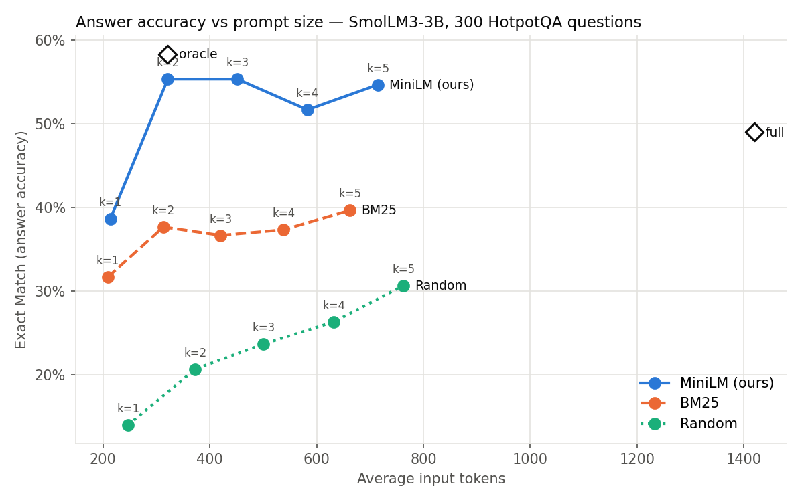

# Prompt Compression with Relevance Maintainer

NLP (CS6120) project. Long prompts are expensive and mostly noise. We trained a **relevance classifier** that scores each context paragraph against the question, so we can compress a prompt to its top-*k* paragraphs **without losing what's needed to answer it**.

## Overview

| Section | Content |
|---|---|
| 0 | **Experiment configuration:** all hyper-parameters in one papermill `parameters` cell, plus the `⏱` cell timer |
| 1–2 | Install dependencies, download and inspect HotpotQA |
| 3–4 | **Whole dataset** (train + validation, 97,852 questions), **80/20 train/test split by question** with a 5% dev set held out of train, expanded into paragraph pairs |
| 5 | Baseline: TF-IDF + logistic regression |
| 6 | Export 250 random questions to Excel for manual review |
| 7 | BM25 ranking, scored on the test questions and on the whole dataset |
| 8 | Fine-tune the `cross-encoder/ms-marco-MiniLM-L-6-v2` cross-encoder, compare all models, compression demo |
| 9 | **End-to-end answer test:** a local LLM (`SmolLM3-3B`) answers 300 test questions from full, oracle, random, BM25 and MiniLM-compressed prompts (k = 1–5), scored with Exact Match / F1 against tokens saved, with McNemar significance tests. Run `r6_qwen3_4b` repeats it with `Qwen3-4B` as the reader |
| 10 | **Experiment report:** every setting, metric and timing → `results/experiments.csv`; only the best MiniLM model is kept |

Everything is in [`relevance_classifier.ipynb`](relevance_classifier.ipynb). [`run_experiments.py`](run_experiments.py) runs the whole notebook once per hyper-parameter combination.

## Metrics

We evaluate two things: **(A)** does the relevance model keep the right paragraphs, and **(B)** does the LLM still answer correctly from the compressed prompt, and how much smaller is it?

### A. Relevance model

| Metric | What it tells us |
|---|---|
| **Accuracy** | Share of paragraphs classified correctly. Misleading on its own: 80% of paragraphs are distractors, so dropping everything scores 80%. |
| **Precision** | Of the paragraphs kept, how many were needed. Higher → more compression. |
| **Recall** | Of the paragraphs needed, how many were kept. Higher → evidence survives. This matters most: a dropped paragraph can make the answer impossible, an extra distractor only costs tokens. |
| **F1** | Balance of precision and recall. |
| **ROC-AUC** | Ranking quality without a threshold (0.5 = random, 1.0 = perfect). |
| **All gold in top-k** | Share of questions with every gold paragraph in the top-k of 10. **Our main compression metric.** k = 2 keeps 20% of the context. |

### B. End-to-end

| Metric | Meaning |
|---|---|
| **EM / answer F1** | Exact match and word-overlap partial credit against the gold answer (not the classification F1 above). |
| **Token reduction** | Share of prompt tokens removed vs. the full prompt. |
| **EM retained** | Condition EM ÷ full-prompt EM. Above 100% means the compressed prompt scored higher than the full one. |
| **Answer preservation** | Of the questions the full prompt got right, the share still right after compression. |
| **Fixed / broken** | Questions compression turned wrong → right and right → wrong. |
| **Tokens per correct answer** | Prompt tokens ÷ correct answers. Lower is better. |
| **p-value / 95% CI** | McNemar's test on the same questions: how likely an EM difference is just luck, and the range the real change probably lies in. |

A good compressor shows **high token reduction with high answer preservation and few broken answers**.

---

## Approach

```
                 ┌──────────────────────── OUR PROJECT ─────────────────────────┐
question  ──┐    │                                                              │
            ├──► │  Relevance model scores every paragraph against the question │
10 paragraphs┘   │  → keep the top-k (e.g. k = 3) → put them back in order      │
                 └───────────────────────────────┬──────────────────────────────┘
                                                 │  compressed prompt (~70% fewer tokens)
                                                 ▼
                                   Answering LLM reads it → writes the answer
```

There are two separate models: the **relevance model** we train (it only scores paragraphs), and the **answering LLM** (Section 9) that reads the compressed prompt.

### Data: HotpotQA (Sections 1–2)

We used [HotpotQA](https://huggingface.co/datasets/hotpotqa/hotpot_qa) (`distractor` config), a multi-hop QA dataset. Each question comes with **10 paragraphs: 2 gold, 8 distractors** chosen for word overlap with the question. A paragraph is labelled relevant if its title appears in `supporting_facts`. Gold evidence averages ~72 words against ~944 for the full context, so **only ~8% of each prompt matters**.

Two question types matter throughout:
- **Comparison** ("Which airport is in Maine, A or B?"): both entities are in the question, so word matching finds them.
- **Bridge** ("What nationality was James Henry Miller's wife?"): the second-hop paragraph (about Peggy Seeger) never mentions Miller, so it's the hardest case.

### Splits and training pairs (Sections 3–4)

- Whole dataset: `train` (90,447) + `validation` (7,405) = 97,852 questions (`SAMPLE_FRAC = 1.0`).
- **80/20 train/test split by question** (`TEST_FRAC = 0.20`), with **5% of train held out as dev** (`DEV_FRAC = 0.05`): ≈74.4k train, ≈3.9k dev, ≈19.6k test. Dev is used only for model selection.
- Fixed seed (`SEED = 42`), so every model is compared on the same test questions.
- Each question becomes 10 `(qid, question, paragraph, label)` rows, where `paragraph` = title + text. That gives ~740k train, 39k dev and 195k test pairs, 20% positive; we handle the imbalance with class weights.

### Baselines (Sections 5, 7)

- **TF-IDF + logistic regression:** element-wise product of question and paragraph TF-IDF vectors (uni/bigrams, fitted on train only) plus cosine similarity, `class_weight="balanced"`. Word overlap only.
- **BM25:** unsupervised (`k1 = 1.5`, `b = 0.75`), IDF computed across the whole dataset. Scored on the test questions like the other models, and on the whole dataset as a check.

### Manual review sheet (Section 6)

`data/hotpotqa_250_manual_review.xlsx` holds 250 random questions with evidence sentences, all 10 paragraphs tagged **★ RELEVANT** or *distractor*, and an empty `notes` column for inspecting failures.

### MiniLM cross-encoder (Section 8)

We fine-tuned `cross-encoder/ms-marco-MiniLM-L-6-v2`: already trained for query–passage relevance on MS MARCO, small (6 layers, ~22M params) and fast at inference, which matters because a compressor scores every chunk of every prompt.

1. **Zero-shot evaluation** to measure how much MS MARCO transfers on its own.
2. **Fine-tuning** on ~740k pairs: weighted BCE (`pos_weight` ≈ 4), AdamW (default LR 2e-5), 10% warm-up then linear decay, gradient clipping, bf16 + TF32. About 10–20 min per epoch on an RTX 5070 Ti. The model is saved to `models/minilm-run-<RUN_NAME>/`; if that folder exists, training is skipped. With `TRAIN_MINILM = False` a run reuses the saved best model instead of training.
3. **Comparison** against TF-IDF and BM25 on the same test set, plus the dev score used for model selection.
4. **Compression demo** on one real prompt.

For ranking evaluation, we score all 10 paragraphs, keep the top *k* by score, and check whether **both** gold paragraphs survived. *k* is the compression dial: k = 2 keeps 20% of the context, k = 3 keeps 30%, k = 5 keeps 50%.

### End-to-end answer test (Section 9)

"All gold in top-k" is a proxy, so we also check whether the answer is still right. For 300 test questions (`N_EVAL_QUESTIONS`), we give the **same LLM the same instruction** with different contexts:

| Condition | Context | Purpose |
|---|---|---|
| `full` | all 10 paragraphs | reference |
| `oracle` | the 2 gold paragraphs | ceiling |
| `random@k` | k random paragraphs | floor |
| `bm25@k` | BM25's top-k | word-overlap baseline |
| `minilm@k` | MiniLM's top-k | **our model** |

Each `@k` runs at k = 1–5: 17 conditions × 300 = 5,100 answers per run.

**Answering LLM.** `HuggingFaceTB/SmolLM3-3B`, local, bf16 (~6 GB VRAM), greedy decoding, thinking mode off, and `/system_override` to keep the date out of the prompt. We switched from `Qwen/Qwen3-4B-Instruct-2507` (run 0) because it ran out of memory on a 16 GB card. With the memory fixes below it now runs as a second reader (`r6_qwen3_4b`, see Results).

**Prompt wording.** SmolLM3 took our original instruction too literally and answered "yes"/"no" to 168 of 300 non-yes/no questions. We A/B tested three versions:

| Instruction | Oracle EM | Oracle F1 | Full EM | Full F1 | Wrong yes/no (oracle) |
|---|---|---|---|---|---|
| original ("a short phrase, yes, or no") | 28.3% | 32.6% | 36.0% | 47.2% | 168 |
| "if yes/no question, yes/no; otherwise a short phrase" | 57.7% | 67.7% | 45.0% | 56.8% | 31 |
| **"shortest phrase from the context; yes/no only for yes/no questions"** (used) | **58.3%** | **70.2%** | **48.0%** | **58.2%** | **7** |

*These numbers come from the A/B runs, so they differ slightly from the final results below. The A/B test used the same 300 test questions as the results, so the wording was picked on test data. It should be repeated on dev questions.*

**GPU memory.** Run 0 crashed with CUDA OOM on the longest prompts after Windows started spilling VRAM into system RAM. We fixed it with:
- **Token-budget batching:** a batch closes at `GEN_BATCH_SIZE` (16) prompts or `GEN_MAX_BATCH_TOKENS` (16,384; 4,096 for Qwen3-4B) tokens, whichever comes first.
- **A hard VRAM cap:** free VRAM at start-up minus `GPU_HEADROOM_GB` (1 GB), or `GPU_MAX_GB` if that is lower (12 GB for Qwen3-4B). PyTorch never allocates beyond the cap, so VRAM can't spill into system RAM.
- **Automatic retry:** an OOM batch is split in half and retried; the number of splits is saved in the report.

**Caching.** Answers are cached in `results/e2e_cache_<model>.jsonl`, keyed by a hash of the prompt plus the model and generation settings. Prompts shared across runs are generated once; `minilm@k` prompts regenerate only when the kept paragraphs change. Interrupted runs resume. The settings include the `transformers` version, so changing library versions regenerates every answer.

**Scoring** uses the official HotpotQA EM / F1 with standard answer normalisation.

### Hyper-parameter sweep (Section 10, `run_experiments.py`)

[`run_experiments.py`](run_experiments.py) uses [papermill](https://papermill.readthedocs.io) to run the full notebook once per combination:

| Run | `TRAIN_BATCH_SIZE` | `LEARNING_RATE` | `EPOCHS` | `MAX_LENGTH` |
|---|---|---|---|---|
| `r1_baseline` | 32 | 2e-5 | 1 | 256 |
| `r2_bs16` | 16 | 2e-5 | 1 | 256 |
| `r3_bs64_lr4e-5` | 64 | 4e-5 | 1 | 256 |
| `r4_len384` | 32 | 2e-5 | 1 | 384 |
| `r5_2epochs` | 32 | 2e-5 | 2 | 256 |
| `r6_qwen3_4b` | 32 | 2e-5 | 2 | 256 (r5's model, not retrained) |

All runs share the same split, `N_EVAL_QUESTIONS = 300`, `K_VALUES = [1, 2, 3, 4, 5]` and `GEN_BATCH_SIZE = 16`. Runs 1–5 use SmolLM3-3B. `r6_qwen3_4b` does not train: it reuses r5's MiniLM (`TRAIN_MINILM = False`) and swaps the reader for `Qwen/Qwen3-4B-Instruct-2507`, under a hard 12 GB VRAM limit (`GPU_MAX_GB = 12`) with `GEN_MAX_BATCH_TOKENS = 4096`.

Each run produces `experiments/<run>.ipynb`, one row in `results/experiments.csv` (settings, all metrics, `⏱` timings, peak VRAM), and `results/runs/<run>_answers.csv` + `<run>_accuracy_vs_tokens.png`.

**Model selection:** each run's MiniLM is compared with the best so far on **dev** top-2 (tracked in `models/minilm-hotpotqa-best/best_run.json`). The winner is kept and the rest deleted. Test never influences selection. `r6_qwen3_4b` reuses the best model and takes no part in the selection.

**Next step: GSM8K.** Everything after the evaluation-set cell only depends on questions, chunks, gold positions and scores, so we plan to reuse it with few-shot worked examples as the chunks and a numeric-answer metric.

---

## Results

All numbers come from `results/experiments.csv` unless a note says otherwise. Each run's executed notebook is in `experiments/<run>.ipynb`. The best run, `r5_2epochs`, was later re-run in the main notebook (Python 3.12, transformers 5.17.0). Its current numbers are in [`relevance_classifier.ipynb`](relevance_classifier.ipynb); `experiments/r5_2epochs.ipynb` is the original sweep run. The re-runs reproduced the MiniLM metrics within 0.04 points, but the LLM answers moved by a few questions (see [How reliable are the end-to-end numbers?](#how-reliable-are-the-end-to-end-numbers)). For runs 1–4, the accuracy and compression metrics were computed from their saved answers. Hardware: RTX 5070 Ti (16 GB), Intel Core Ultra 7 265KF, 32 GB RAM.

### Relevance models (19,571 test questions, best run `r5_2epochs`)

| Model | Top-2 | Top-3 | Top-4 | Top-5 | ROC-AUC | Accuracy | Precision | Recall | F1 |
|---|---|---|---|---|---|---|---|---|---|
| TF-IDF + LR | 19.1% | 29.4% | 37.8% | 44.9% | 0.642 | 0.658 | 0.306 | 0.555 | 0.395 |
| BM25 (unsupervised) | 25.9% | 37.6% | 45.0% | 51.2% | 0.667 | – | – | – | – |
| MiniLM zero-shot (MS MARCO only) | 44.3% | 58.1% | 66.3% | 71.8% | 0.813 | 0.725 | 0.404 | 0.776 | 0.531 |
| **MiniLM fine-tuned** | **89.1%** | **95.5%** | **97.6%** | **98.7%** | **0.989** | **0.957** | **0.866** | **0.928** | **0.896** |

*Top-k = share of test questions with both gold paragraphs in the top-k of 10. Classification metrics are for the relevant class at p ≥ 0.5; BM25 has no probability. BM25 needs no training, so Section 7 also scores it on the whole dataset (97,852 questions) as a check: 25.6% / 37.1% / 44.8% / 51.0%, ROC-AUC 0.666.*

- The trivial "all irrelevant" model scores **79.9%** accuracy. TF-IDF and zero-shot MiniLM score below that but are still far more useful (55% and 78% recall vs. 0%). Only the fine-tuned model is strong on every measure.
- Word-overlap methods plateau because HotpotQA's distractors were picked for word overlap: BM25 keeps all evidence in only half the prompts even at top-5. Our fine-tuned cross-encoder does it in the top-2 for 89% of questions.

### Hyper-parameter sweep (5 runs)

| Run | Batch | LR | Epochs | Max len | **Dev top-2** | Test top-2 | Test top-3 | ROC-AUC | Accuracy | Precision | Recall | F1 | Final loss | Fine-tune time | Total time |
|---|---|---|---|---|---|---|---|---|---|---|---|---|---|---|---|
| `r1_baseline` | 32 | 2e-5 | 1 | 256 | 87.46% | 87.12% | 94.65% | 0.9866 | 0.948 | 0.833 | 0.929 | 0.878 | 0.278 | 11.1 min | 22.7 min |
| `r2_bs16` | 16 | 2e-5 | 1 | 256 | 88.56% | 87.65% | 94.84% | 0.9873 | 0.956 | **0.880** | 0.904 | 0.892 | 0.346 | 17.1 min | 23.9 min |
| `r3_bs64_lr4e-5` | 64 | 4e-5 | 1 | 256 | 88.58% | 88.18% | 95.07% | 0.9881 | 0.947 | 0.822 | **0.942** | 0.878 | 0.252 | **9.7 min** | **16.6 min** |
| `r4_len384` | 32 | 2e-5 | 1 | 384 | 87.92% | 87.28% | 94.68% | 0.9867 | 0.949 | 0.838 | 0.925 | 0.879 | 0.270 | 14.6 min | 22.2 min |
| **`r5_2epochs`** (best) | 32 | 2e-5 | 2 | 256 | **89.25%** | **89.07%** | **95.48%** | **0.9893** | **0.957** | 0.866 | 0.928 | **0.896** | 0.199 | 52.0 min | 59.3 min |

*`r5_2epochs` shows its latest re-run. Its fine-tuning took 52 min, against about 22 min in its earlier runs with the same settings, so its times can't be compared with the other rows. Almost all of its LLM answers came from the cache.*

- **Two epochs win** on dev and on every test ranking metric: +1.9 points top-2 over the baseline (381 more questions whose evidence survives 20% compression). Dev and test agree.
- `r3` has the highest recall but lowest precision; `r2` is the opposite. `r5` balances both best.
- `r3` (batch 64, LR 4e-5) is the best one-epoch setting and the fastest run.
- `MAX_LENGTH = 384` adds time but no gain; almost every pair fits in 256 tokens.
- Peak VRAM: 1.6–2.3 GiB training, up to 8.5 GiB generating (cap 13.7 GiB). No spills or OOMs.
- The answer cache cut later runs' generation from 5.3 min to under 20 s.

### End-to-end answer accuracy (`r5_2epochs`, SmolLM3-3B, 300 test questions)

| Condition | Avg prompt tokens | Token reduction | All gold kept | EM | F1 | EM retained | Answer preservation | Fixed / broken | Tokens per correct answer |
|---|---|---|---|---|---|---|---|---|---|
| `full` (10 paragraphs) | 1,419 | 0% | 100% | 49.0% | 59.5% | 100% | 100% | – | 2,897 |
| `oracle` (2 gold paragraphs) | 321 | 76% | 100% | 58.3% | 69.7% | 119% | 85% | 50 / 22 | 551 |
| `random@1` | 247 | 82% | 0% | 14.0% | 17.1% | 29% | 21% | 11 / 116 | 1,766 |
| `bm25@1` | 209 | 85% | 0% | 31.7% | 38.5% | 65% | 52% | 18 / 70 | 660 |
| **`minilm@1`** | 214 | 84% | 0% | **38.7%** | **48.1%** | **79%** | **63%** | 24 / 55 | **553** |
| `random@2` | 372 | 73% | 2.7% | 20.7% | 25.4% | 42% | 31% | 17 / 102 | 1,802 |
| `bm25@2` | 313 | 77% | 24.0% | 37.7% | 44.8% | 77% | 60% | 25 / 59 | 831 |
| **`minilm@2`** | 321 | 76% | **89.7%** | **55.3%** | **66.8%** | **113%** | **81%** | **47 / 28** | **581** |
| `random@3` | 501 | 64% | 6.0% | 23.7% | 27.3% | 48% | 38% | 15 / 91 | 2,115 |
| `bm25@3` | 420 | 69% | 38.7% | 36.7% | 44.4% | 75% | 59% | 23 / 60 | 1,146 |
| **`minilm@3`** | 452 | 67% | **95.7%** | **55.3%** | **67.1%** | **113%** | **83%** | 44 / 25 | **816** |
| `random@4` | 632 | 55% | 12.7% | 26.3% | 33.6% | 54% | 46% | 12 / 80 | 2,402 |
| `bm25@4` | 538 | 61% | 44.7% | 37.3% | 45.3% | 76% | 63% | 20 / 55 | 1,442 |
| **`minilm@4`** | 583 | 58% | **98.3%** | **51.7%** | **63.8%** | **105%** | **86%** | 29 / 21 | **1,128** |
| `random@5` | 763 | 46% | 21.0% | 30.7% | 38.7% | 63% | 51% | 17 / 72 | 2,487 |
| `bm25@5` | 662 | 52% | 52.3% | 39.7% | 48.0% | 81% | 67% | 20 / 48 | 1,670 |
| **`minilm@5`** | 715 | 49% | **98.3%** | **54.7%** | **65.1%** | **112%** | **92%** | 29 / 12 | **1,308** |



- **MiniLM top-2 removes 76% of the prompt** (1,419 → 321 tokens) and keeps **81% of the full prompt's correct answers**, while fixing 47 and breaking 28. EM rises from 49.0% to 55.3%, 3 points below the oracle. That gain is only borderline significant (see below).
- **5× cheaper per correct answer:** 581 tokens with `minilm@2` vs. 2,897 with the full prompt (BM25: 831, random: 1,802).
- **Not all lost answers are compression's fault.** Even the oracle preserves only 85%. Of the 25 answers `minilm@3` lost, 92% still had all gold paragraphs. So the evidence was there, and the errors came from how the reader LLM answered or from strict EM scoring (e.g. "Housman" for "A. E. Housman").
- **k = 2–3 is the sweet spot:** the best EM, at close to the lowest cost per correct answer (k = 1 is slightly cheaper per correct answer, but its EM is 10 points below the full prompt). Answer preservation climbs from 63% (k = 1) to 92% (k = 5), but EM does not improve beyond k = 3.
- **BM25 loses accuracy** because it drops a gold paragraph in 76% of questions at k = 2. Random is far worse.
- **LLM-accuracy differences between runs are noise:** `minilm@2` scores 54.7–55.3% EM across all five SmolLM3 runs, and runs 1–4 share most of their answers through the cache. The relevance metrics on 19,571 questions are what separate them.

### How reliable are the end-to-end numbers?

**Run-to-run noise.** The same 300 full prompts were answered three times: in the sweep (r1's answers, reused through the cache), in a re-run on Nov 3, and in a re-run on Nov 12 (the current run reuses those answers through the cache). Full-prompt EM came out at 48.0%, 49.3% and 49.0%. The prompts were identical. The answers changed because batched bf16 generation is not *batch-invariant*: a prompt's answer can depend on which other prompts share its batch, and that changes whenever MiniLM is retrained or the cache is cleared. Between the first two runs (same software), 79 of the 3,600 answers that don't depend on MiniLM changed. So read any single EM number as ±1–1.5 points. The earlier answer files are in git history (commits `0257ff5` and `051fd7d`).

**Significance.** Section 9 runs McNemar's exact test on the 300 questions; every value is also saved in `experiments.csv`. It compares two conditions on the same questions and only counts the questions where they disagree. Wins / losses = questions that only the first / only the second condition got right. `p (Holm)` corrects for testing five values of k.

| Comparison | Wins / losses | EM change | p-value | p (Holm) | 95% CI of the change |
|---|---|---|---|---|---|
| `minilm@1` vs `full` | 24 / 55 | −10.3 pts | 0.0006 | 0.003 | −16.0 to −4.6 |
| `minilm@2` vs `full` | 47 / 28 | +6.3 pts | 0.037 | 0.089 | +0.7 to +11.9 |
| `minilm@3` vs `full` | 44 / 25 | +6.3 pts | 0.030 | 0.089 | +1.0 to +11.7 |
| `minilm@4` vs `full` | 29 / 21 | +2.7 pts | 0.32 | 0.32 | −1.9 to +7.3 |
| `minilm@5` vs `full` | 29 / 12 | +5.7 pts | 0.012 | 0.046 | +1.5 to +9.8 |
| `minilm@2` vs `bm25@2` | 61 / 8 | +17.7 pts | < 0.001 | < 0.001 | +12.6 to +22.7 |

- **MiniLM clearly beats BM25** at every k (p < 0.01, also after the Holm correction).
- **"Compression beats the full prompt" is only borderline.** At k = 2 the p-value was 0.019 in the sweep, 0.050 in the Nov 3 re-run and 0.037 now. After the Holm correction, only k = 5 stays significantly better than the full prompt, and k = 1 is significantly worse.
- **More questions would settle it.** With 300 questions the confidence interval is about ±5.6 points; 1,000 questions would narrow it to about ±3 points.

### Second reader: Qwen3-4B (`r6_qwen3_4b`, 300 test questions)

Same 300 questions, same prompts and the same MiniLM model as `r5_2epochs`; only the answering LLM changes, to `Qwen/Qwen3-4B-Instruct-2507`. It ran under a hard 12 GB VRAM limit with 4,096-token batches: peak 10.6 GB, no batch ran out of memory, and 4,446 prompts took 9.1 min. Prompt token counts are a little higher than in the SmolLM3 table because the chat templates differ.

| Condition | Avg prompt tokens | Token reduction | EM (SmolLM3-3B) | EM (Qwen3-4B) | F1 (Qwen3-4B) | Answer preservation | Fixed / broken | Tokens per correct answer |
|---|---|---|---|---|---|---|---|---|
| `full` (10 paragraphs) | 1,479 | 0% | 49.0% | 69.3% | 78.3% | 100% | – | 2,133 |
| `oracle` (2 gold paragraphs) | 329 | 77% | 58.3% | 78.7% | 87.4% | 98% | 32 / 4 | 418 |
| `random@2` | 382 | 73% | 20.7% | 20.7% | 24.6% | 28% | 4 / 150 | 1,848 |
| `bm25@2` | 320 | 77% | 37.7% | 45.7% | 53.3% | 62% | 8 / 79 | 700 |
| **`minilm@1`** | 216 | 85% | 38.7% | 45.3% | 53.5% | 58% | 16 / 88 | 476 |
| **`minilm@2`** | 329 | 77% | 55.3% | **73.7%** | **82.5%** | **95%** | 24 / 11 | **446** |
| **`minilm@3`** | 465 | 67% | 55.3% | 72.7% | 81.7% | 95% | 21 / 11 | 641 |
| **`minilm@4`** | 603 | 58% | 51.7% | 74.0% | 81.9% | 96% | 23 / 9 | 814 |
| **`minilm@5`** | 741 | 49% | 54.7% | 70.3% | 79.7% | 95% | 13 / 10 | 1,054 |

*Answer preservation and fixed / broken compare Qwen3-4B with its own full prompt. All 17 conditions are in `experiments/r6_qwen3_4b.ipynb` and `results/runs/r6_qwen3_4b_answers.csv`.*

McNemar's test (Section 9 of the r6 notebook):

| Comparison | Wins / losses | EM change | p-value | p (Holm) | 95% CI of the change |
|---|---|---|---|---|---|
| `minilm@1` vs `full` | 16 / 88 | −24.0 pts | < 0.001 | < 0.001 | −30.1 to −17.9 |
| `minilm@2` vs `full` | 24 / 11 | +4.3 pts | 0.041 | 0.12 | +0.5 to +8.2 |
| `minilm@3` vs `full` | 21 / 11 | +3.3 pts | 0.11 | 0.22 | −0.3 to +7.0 |
| `minilm@4` vs `full` | 23 / 9 | +4.7 pts | 0.020 | 0.080 | +1.0 to +8.3 |
| `minilm@5` vs `full` | 13 / 10 | +1.0 pts | 0.68 | 0.68 | −2.1 to +4.1 |
| `minilm@2` vs `bm25@2` | 89 / 5 | +28.0 pts | < 0.001 | < 0.001 | +22.5 to +33.5 |

- **Qwen3-4B is a much stronger reader:** full-prompt EM 69.3% vs 49.0% for SmolLM3, and 78.7% vs 58.3% with only the gold paragraphs.
- **Compression keeps the accuracy with the stronger reader too.** MiniLM top-2 removes 77% of the prompt and keeps 95% of the correct answers (24 fixed, 11 broken), with EM 73.7% vs 69.3%. Before the correction k = 2 and k = 4 look slightly better (p = 0.041 and 0.020), but after the Holm correction no k ≥ 2 differs significantly from the full prompt. The safe claim is "no loss of accuracy at about a quarter of the tokens". Only k = 1 is clearly worse (−24 points).
- **The SmolLM3 gain is smaller here.** With SmolLM3, compression scored above the full prompt; with Qwen3-4B the gain is smaller and not significant. This fits the idea that a weaker reader is more easily distracted by extra paragraphs, but this experiment alone doesn't prove it.
- **MiniLM beats BM25 by even more:** +19 to +28 EM points at k = 2–5 (p < 0.01 at every k after Holm). BM25 at k = 2 still drops a gold paragraph in 76% of questions, and the stronger reader can't make up for that.
- **4.8× cheaper per correct answer:** 446 tokens with `minilm@2` vs 2,133 with the full prompt.

### Run 0: original configuration with Qwen3-4B

Our first GPU run used a 30% sample (75/25 split), 1 epoch on 20,350 questions, `Qwen/Qwen3-4B-Instruct-2507` as the reader, 500 questions and k = 2, 3, 5. It hit CUDA OOM after 5,472 of 5,500 answers, which led to the batching and VRAM fixes above. Its raw answers were not kept, so the table below is the only record of this run; `r6_qwen3_4b` above repeats it on the current setup.

| Condition | Answers | Avg prompt tokens | All gold kept | EM | F1 |
|---|---|---|---|---|---|
| `full` | 472 / 500 | 1,407 | 100% | 65.0% | 72.3% |
| `oracle` | 500 | 305 | 100% | 77.4% | 83.7% |
| `random@2` / `bm25@2` / **`minilm@2`** | 500 | 346 / 302 / 304 | 2.8% / 25.6% / **82.8%** | 17.8% / 41.0% / **70.8%** | 19.9% / 44.7% / **76.4%** |
| `random@3` / `bm25@3` / **`minilm@3`** | 500 | 489 / 415 / 434 | 9.0% / 35.2% / **90.6%** | 25.8% / 43.6% / **69.8%** | 27.8% / 47.2% / **76.6%** |
| `random@5` / `bm25@5` / **`minilm@5`** | 500 | 761 / 660 / 697 | 22.6% / 48.2% / **95.8%** | 35.8% / 49.0% / **68.4%** | 39.0% / 54.0% / **75.0%** |

The larger reader is more accurate overall, and the picture is the same: **MiniLM top-2 scores above the full prompt (70.8% vs 65.0% EM) at ~1/5 of the tokens.** This run was not tested for significance and `full` is missing 28 answers, so it is supporting evidence only. Training on the whole dataset raised MiniLM's k = 2 evidence retention from 82.8% to 89.7% (different question samples, so indicative only).

## Setup

```bash
# Project virtual environment (Windows; on Linux/macOS use .venv/bin/python)
py -3.14 -m venv .venv
.venv\Scripts\python -m pip install torch --index-url https://download.pytorch.org/whl/cu128   # CUDA build (RTX 50-series needs CUDA 12.8+)
.venv\Scripts\python -m pip install -r requirements.txt

# Register it as a Jupyter kernel, then pick "Prompt Optimizer NLP (.venv, CUDA)" in VS Code / Jupyter
.venv\Scripts\python -m ipykernel install --user --name prompt-optimizer-nlp --display-name "Prompt Optimizer NLP (.venv, CUDA)"
```

**Single run:** open the notebook and Run All. Section 1 should print `CUDA: True` and the GPU name.

**Full sweep** (5 sweep runs + `r6_qwen3_4b`, ~3–4 h on an RTX 5070 Ti):

```bash
.venv\Scripts\python run_experiments.py              # all runs; finished runs are skipped
.venv\Scripts\python run_experiments.py r4_len384    # a single run
.venv\Scripts\python run_experiments.py r6_qwen3_4b  # second reader; needs r5's saved model, so run it after r5
```

- Sections 1–8 fall back to CPU without a GPU, but that's too slow for the whole dataset; lower `SAMPLE_FRAC` / `TRAIN_FRAC`.
- Section 9 needs a CUDA GPU (~6 GB model download for SmolLM3, ~8 GB for Qwen3-4B; 5–15 min per run). If memory is tight, lower `GEN_MAX_BATCH_TOKENS`.
- Delete `results/e2e_cache_*.jsonl` to force all answers to regenerate.
- To redo the sweep from scratch, delete `results/experiments.csv` and `models/minilm-hotpotqa-best/`.

## Repository layout

```
relevance_classifier.ipynb            main notebook (Sections 0–10)
run_experiments.py                    runs the notebook once per run setting (papermill)
data/hotpotqa_250_manual_review.xlsx  250-question sheet for manual notes (never overwritten by the notebook)
requirements.txt
experiments/                          executed notebook of every run (r1–r6)
results/experiments.csv               one row per run: settings, metrics, timings, peak VRAM
results/runs/                         per-run LLM answers and accuracy-vs-tokens plot
results/e2e_cache_*.jsonl             cached LLM answers (git-ignored)
models/minilm-hotpotqa-best/          the best fine-tuned MiniLM across runs + best_run.json (git-ignored)
```